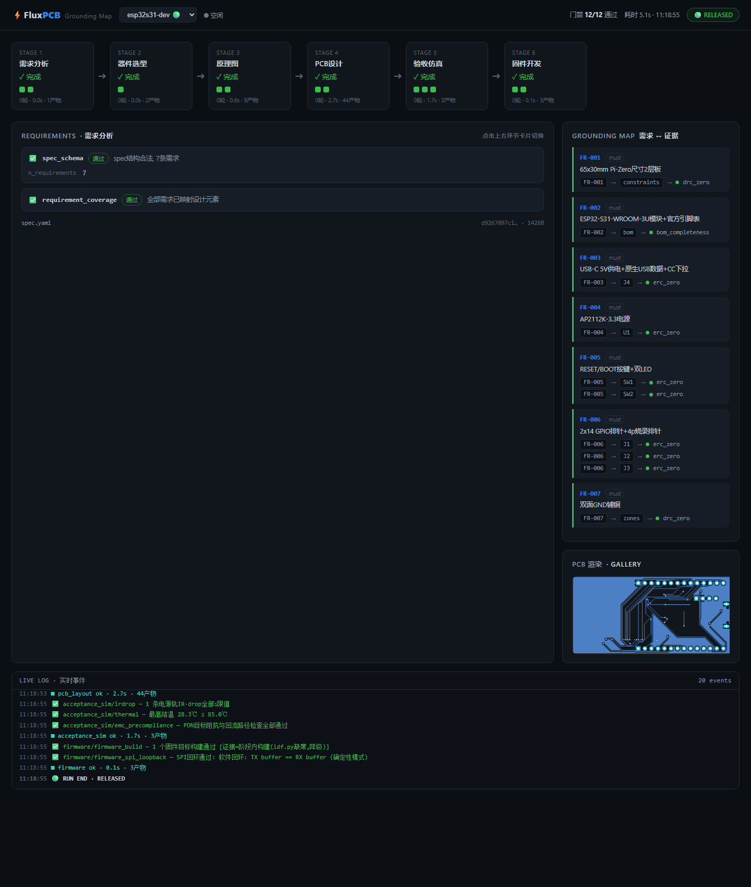

# FluxPCB

**全自动AI电路设计流水线** — 需求分析 → 器件选型 → 原理图 → PCB设计 → 验收仿真 → 固件开发,六环节一键贯通,每一步都有机器可判定的验证门禁。

```
需求 ──▶ spec.yaml ──▶ BOM ──▶ 原理图 ──▶ PCB ──▶ 仿真验证 ──▶ 固件
         ▲            ▲        ▲          ▲         ▲           ▲
         └────────────┴────────┴──────────┴─────────┴───────────┘
                    门禁失败 → 结构化反馈 → 自动重生成(有界迭代)
```

## 设计哲学(源自371个GitHub AI-PCB项目的实证分析)

1. **AI提议,物理裁决** — LLM负责生成,确定性求解器与EDA工具负责打分,绝不让LLM直接算物理量。
2. **门禁即规范** — "设计完成"的唯一定义是全部门禁绿灯:ERC/DRC零错、阻抗、IR-drop、热、EMC预合规、真实工具链编译。门禁全部机器可判定,失败产生结构化反馈回流。
3. **全程可审计** — 每个产出物带SHA256,每次运行产出完整报告,任何结论可追溯到证据。
4. **可复现** — `flux run projects/xxx` 一条命令重放整个设计流程。

## 快速开始

```bash
pip install -e .
flux run projects/esp32s31-mini      # 一条命令: 自动布局+自动布线+16门禁全绿 → RELEASED
flux run projects/esp32s31-dev       # 旗舰案例(树莓派Zero尺寸)
flux report projects/esp32s31-mini  # 查看审计报告
flux gate projects/esp32s31-dev --only impedance_si,irdrop   # 单独跑门禁
flux verify projects/esp32s31-mini  # 只复检门禁(对磁盘产物,不重新生成)
flux dashboard projects              # 本地Grounding Map可视化面板 → http://127.0.0.1:8765
```

**一句话 → 加工图+固件**：esp32s31-mini 由自然语言需求("ESP32-S31迷你开发板：USB-C供电+双排针+1按键+1LED")出发，`flux run` 一条命令完成：partslib真实选型(17个LCSC C号) → 规则式自动布局 → **流水线内自动布线**(Freerouting批量+碰撞感知L形收尾+违例清洗) → ngspice蒙特卡洛 → ESP-IDF固件+主机C回归 → fab包(Gerber+钻孔+坐标+STEP 3D)。

## Grounding Map 可视化面板

`flux dashboard` 启动零依赖本地网页(127.0.0.1,离线可用),实时监控六环节流水线:

- **流水线轨道** — 六环节卡片:状态/迭代轮数/耗时/产物数,门禁红绿灯
- **门禁证据** — 点击环节查看每个门禁的物理指标条(结温余量、IR-drop%、PDN阻抗),结论可追溯到带SHA256的产物
- **Grounding Map** — 每条需求(FR-xxx) → 覆盖它的设计元素 → 裁决门禁,未覆盖需求高亮
- **LIVE LOG** — 流水线运行时逐事件滚动(`flux run` 与面板可同时开)



## Claude Code 集成(/fluxpcb)

仓库自带 `.claude/commands/fluxpcb.md`,在 Claude Code 中打开本仓库后:

```
/fluxpcb 树莓派Zero大小的ESP32开发板,带USB-C和双排针
```

一句话需求 → 自动建项目、写spec、跑六环节流水线、修门禁(有界重试)、导出fab包、汇报结果。规则内置于命令:不得编造datasheet外的引脚、不得调门禁阈值放水。

## 工具链(全部可选,缺失时相关门禁进入blocked状态)

| 工具 | 用途 | 环节 |
|---|---|---|
| KiCad 10+ (kicad-cli) | 原理图/PCB生成、ERC、DRC、网表 | 原理图/PCB设计 |
| ngspice | 电路功能仿真+蒙特卡洛 | 验收仿真 |
| openEMS + gerber2ems | 阻抗/S参数/EM场终验 | 验收仿真 |
| Freerouting | 自动布线(DSN/SES) | PCB设计 |
| ESP-IDF / hpm-sdk | 固件真实编译门禁 | 固件开发 |
| LCSC/JLC API | 器件选型与BOM | 器件选型 |

内置纯Python物理内核(无外部依赖即可运行):IPC-2141阻抗闭式解、FDM IR-drop/热场求解、PDN目标阻抗法。SPICE由KiCad自带的ngspice.dll经ctypes驱动(无需额外安装),LDO电源链瞬态蒙特卡洛(20次,电容/ESR容差采样)。固件纯逻辑(引导序列/去抖/SPI回环/时序)与目标固件共享同一份C源码,在主机编译器上真实执行回归。

## 项目状态

- [x] Phase A — 工具本体:编排引擎+门禁框架+物理内核+CLI(26个单元测试全绿)
- [x] Phase B1 — ESP32-S31开发板:ERC=0,DRC=0,12/12门禁绿,Gerber导出 ✅
- [ ] Phase B2 — HPM6E80核心板(球阵映射待FAE数据手册)

---

## 项目案例

### 案例 1:ESP32-S31 开发板

**Prompt:**

> 只绘制一个树莓派Zero大小的esp32 s31开发板

**效果展示:**


<details>
<summary>查看更多渲染图</summary>


</details>

**验证结果:** 12/12门禁全绿 · KiCad ERC=0 · DRC=0 · Gerber已导出

| | |
|---|---|
| 板卡 | ESP32-S31 WiFi6开发板,65×30mm,2层 |
| 主控 | ESP32-S31-WROOM-3U(RISC-V双核320MHz) |
| 接口 | USB-C(供电+数据) · 28 GPIO · 烧录口 |
| 📦 下载 | [完整PCB项目](gallery/esp32s31-dev/esp32s31-dev-pcb.zip)(144KB) |
| 📋 详情 | [gallery/esp32s31-dev/prompt.md](gallery/esp32s31-dev/prompt.md) |

---


### 案例 2:esp32s31-mini(全自动演示)

**Prompt**: `ESP32-S31迷你开发板:USB-C供电 + 双排针(2×8P 2.54mm) + 1个RESET按键 + 1个电源LED,板子尽量小(约52×30mm),2层板`

**一条命令**: `flux run projects/esp32s31-mini` → **16/16门禁全绿 🟢 RELEASED**

规则式自动布局(功能分区+1.27网格+去耦就近) + 流水线内自动布线(Freerouting批量+碰撞感知收尾+违例清洗,DRC零违例) + ngspice LDO瞬态蒙特卡洛 + ESP-IDF固件主机C回归,产出fab包(Gerber+钻孔+坐标+STEP 3D)。

详见 [gallery/esp32s31-mini](gallery/esp32s31-mini/prompt.md)。

## License

Apache-2.0
