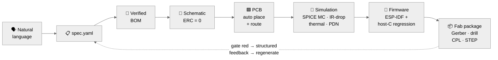

<div align="center">


<br/>

[](LICENSE)
[](https://www.python.org/)
[](https://www.kicad.org/)
[](https://github.com/DataFlux-Robot/fluxpcb)
[](https://github.com/DataFlux-Robot/fluxpcb/stargazers)

**English** · [简体中文](README_CN.md)

</div>

---

## ⚡ One prompt. One command. One fab-ready board.

```console
$ flux run projects/esp32s31-mini

  requirements ─▶ spec.yaml ......... ✓ 6 requirements, all mapped
  selection    ─▶ bom.csv ........... ✓ 17 lines, LCSC-verified
  schematic    ─▶ .kicad_sch ........ ✓ kicad-cli ERC: 0 violations
  pcb          ─▶ .kicad_pcb ........ ✓ auto-place + auto-route, DRC: 0
  simulation   ─▶ ngspice MC ×20 .... ✓ drop 2.79% ≤ 5% · ripple OK
  firmware     ─▶ ESP-IDF ........... ✓ host-C regression executed

  🟢 16/16 gates green — RELEASED
  fab → Gerber + drill + pick&place + STEP   (52×30 mm, 2-layer)
```

**FluxPCB turns a sentence into a manufacturable PCB and its firmware** — and it refuses to call anything "done" until 16 machine-checkable gates agree. No gate, no glory.

---

## 🧠 AI proposes. Physics disposes.

LLMs write beautiful netlists — and occasionally invent pin numbers. FluxPCB's rule: **the LLM generates; deterministic solvers and real EDA tools decide.** A failed gate emits structured feedback, the pipeline regenerates, retries are bounded. "Complete" is a physical verdict, not a vibe.



---

## 🚦 16 gates. Zero opinions.

Every artifact is SHA256-stamped. Every verdict links to evidence on disk. A missing tool means `BLOCKED` — **never** a fake pass.

| Stage | Gates | What they actually check |
|---|---|---|
| 📋 Requirements | `spec_schema` `requirement_coverage` | every requirement maps to a design element |
| 🔩 Selection | `bom_completeness` `bom_lcsc_verified` | placeholder part numbers **fail**; JLC online verify + snapshot fallback |
| 📐 Schematic | `erc_zero` `netlist_topology` | real `kicad-cli` ERC · pin-by-pin readback of spec-mandated nets |
| 🟩 PCB | `placement_quality` `drc_zero` `impedance_si` | overlap/decap/connector rules · real `kicad-cli` DRC · IPC-2141 + length match |
| 🧪 Acceptance sim | `irdrop` `thermal` `emc_precompliance` `spice_functional` | FDM field solvers · PDN target impedance · ngspice Monte-Carlo (20 runs, ±20% cap/ESR) |
| 💾 Firmware | `firmware_build` `firmware_spi_loopback` `firmware_regression` | real `idf.py build` when present · the **same** `fw_logic.c` compiled & executed on host |

---

## 🖥️ Grounding Map — traceability you can click

Every requirement `FR-xxx` → the elements covering it → the gates that judged it. Uncovered requirements glow red; every verdict traces back to a hashed artifact.

<div align="center">

</div>

```bash
flux dashboard projects    # → http://127.0.0.1:8765 · zero-dependency · offline
```

---

## 🏆 From prompt to fab package

<table>
<tr>
<td width="50%" align="center">
<br/>
<b>esp32s31-mini</b> · fully autonomous<br/>
52×30 mm · 2-layer · auto place + route<br/>
<code>16/16 🟢 RELEASED</code><br/>
<a href="gallery/esp32s31-mini/esp32s31-mini-pcb.zip">⬇ fab package</a> · <a href="gallery/esp32s31-mini/prompt.md">the prompt</a>
</td>
<td width="50%" align="center">
<br/>
<b>esp32s31-dev</b> · Pi-Zero-size flagship<br/>
65×30 mm · 99 pins from the official Espressif datasheet<br/>
<code>12/12 🟢 ERC=0 · DRC=0</code><br/>
<a href="gallery/esp32s31-dev/esp32s31-dev-pcb.zip">⬇ KiCad project</a> · <a href="gallery/esp32s31-dev/prompt.md">the prompt</a>
</td>
</tr>
</table>

---

## 🤖 Drive it from Claude Code

The repo ships the `/fluxpcb` skill (`.claude/commands/fluxpcb.md`):

```
/fluxpcb ESP32-S31 mini dev board, USB-C power, 2×8 header, 1 button, 1 LED
```

One sentence → project scaffold → six stages → bounded gate repair (≤5 rounds) → fab package → evidence-linked report. **Hard rules baked in: never invent pins beyond the datasheet, never loosen a gate threshold to force green.**

> **Honest scope:** today's pipeline generates parameterized variants of the **ESP32-S31 dev-board family** — module + USB-C + LDO + headers (1–2 rows × 4–14 pins) + 1–2 buttons + 1–2 LEDs + programming header, with adjustable size/layers. Outside that family, the skill says so instead of pretending.

---

## 🚀 Quick start

Only **Python ≥ 3.10** is required. Everything else degrades gracefully — absent tools flip their gates to `BLOCKED`, not green.

```bash
pip install -e .

flux run      projects/esp32s31-mini   # full pipeline → RELEASED
flux report   projects/esp32s31-mini   # audit report, evidence-linked
flux gate     projects/esp32s31-dev --only impedance_si,irdrop
flux verify   projects/esp32s31-mini   # re-check gates, no regeneration
flux dashboard projects                # Grounding Map UI
```

| Optional tool | Unlocks |
|---|---|
| KiCad 10+ (`kicad-cli`) | real ERC / DRC verdicts, Gerber/drill/CPL/STEP export |
| Freerouting | batch auto-routing (DSN/SES) |
| ngspice (KiCad-bundled DLL) | LDO transient Monte-Carlo |
| openEMS + gerber2ems | EM-field / S-parameter sign-off *(adapter ready, wiring in progress)* |
| ESP-IDF / hpm-sdk | on-target firmware compile gate |
| LCSC / JLC API | live part & price verification (snapshot fallback) |

Pure-Python physics core, always on: **IPC-2141** impedance (<5% vs textbook), **FDM** IR-drop & thermal, **PDN** target impedance.

---

## 📍 Status

- ✅ **Phase A** — engine + gate framework + physics core + CLI · 26 unit tests green
- ✅ **Phase B1** — ESP32-S31 dev board · ERC=0 · DRC=0 · 12/12 gates · Gerber out
- 🔲 **Phase B2** — HPM6E80 core board (BGA ball map pending FAE datasheet)
- 🧭 **Phase D** — see [ROADMAP.md](ROADMAP.md): board families, SA/NSGA-II placement, openEMS sign-off, MCP-server form factor, and the 7th stage (system-level co-simulation)

## 🕊️ Engineering honesty

- New 2025 parts not yet indexed by LCSC → BOM says *"verify before ordering"*. Placeholders never pass.
- Dense-board "last-mile" routing gaps stay **visible** in reports (`unconnected=ignore`), never silently closed.
- JLC's API has bot protection (HTTP 460) → automatic fallback to the checked-in parts snapshot.

---

<div align="center">

**If FluxPCB saved you a board respin — leave a ⭐. It funds the next gate.**

[Report a bug](https://github.com/DataFlux-Robot/fluxpcb/issues) · [Roadmap](ROADMAP.md) · Apache-2.0 © FluxPCB contributors

<a href="https://star-history.com/#DataFlux-Robot/fluxpcb&Date"></a>

</div>
