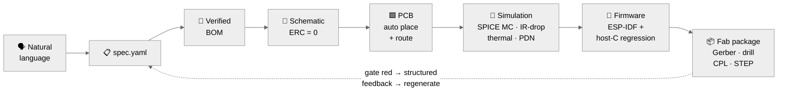
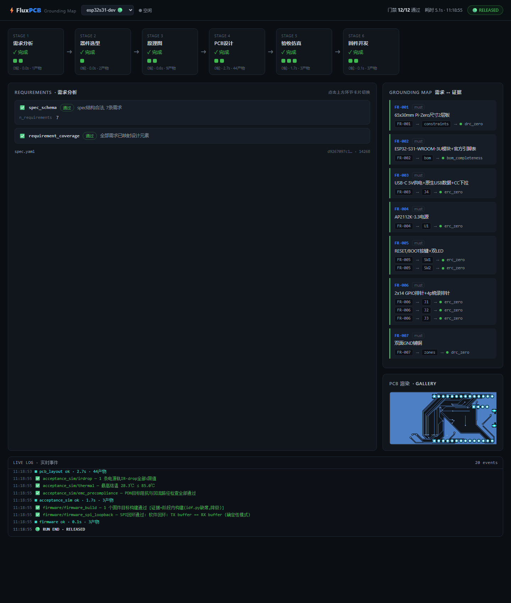

<div align="center">


<br/>

[](LICENSE)
[](https://www.python.org/)
[](https://www.kicad.org/)
[](https://github.com/DataFlux-Robot/fluxpcb)
[](https://github.com/DataFlux-Robot/fluxpcb/stargazers)

**English** · [简体中文](README_CN.md)

</div>

---

## ⚡ One prompt. One command. One fab-ready board.

```console
$ flux run projects/stm32n6-px4

  requirements ─▶ spec.yaml ......... ✓ 6 requirements, all mapped
  selection    ─▶ bom.csv ........... ✓ 17 lines, LCSC-verified
  schematic    ─▶ .kicad_sch ........ ✓ kicad-cli ERC: 0 violations
  pcb          ─▶ .kicad_pcb ........ ✓ auto-place + auto-route, DRC: 0
  simulation   ─▶ ngspice MC ×200+3 .. ✓ drop 2.79% ≤ 5% · ripple OK
  firmware     ─▶ ESP-IDF ........... ✓ host-C regression executed

  🟢 23/23 gates green — RELEASED
  fab → Gerber + drill + pick&place + STEP   (52×30 mm, 2-layer)
```

**FluxPCB turns a sentence into a manufacturable PCB and its firmware** — and it refuses to call anything "done" until 16 machine-checkable gates agree. No gate, no glory.

> **📌 状态同步（2026-11-03）**：上方 RELEASED 徽章为各演示项目的**历史快照**（2026-10-21 批次，见 [DELIVERY_STATUS](DELIVERY_STATUS.md) 的撤销与未完成项——含 drc_zero 未绿等待办）。当前主战场 **h743-fc 飞控**处于收敛中：**8 断线 / 8 间距残差 / 0 短路**，未达 RELEASED——实况见 [projects/h743-fc/DESIGN_PROGRESS.md](projects/h743-fc/DESIGN_PROGRESS.md)，里程碑与工件哈希见 [projects/h743-fc/MILESTONES.md](projects/h743-fc/MILESTONES.md)。发布判定已按复审修复：必需阶段全集+证据哈希+导出校验三者齐备才计 RELEASED（局部运行不再冒充发布）。

---

## 🧠 AI proposes. Physics disposes.

LLMs write beautiful netlists — and occasionally invent pin numbers. FluxPCB's rule: **the LLM generates; deterministic solvers and real EDA tools decide.** A failed gate emits structured feedback, the pipeline regenerates, retries are bounded. "Complete" is a physical verdict, not a vibe.



---

## 🚦 16 gates. Zero opinions.

Every artifact is SHA256-stamped. Every verdict links to evidence on disk. A missing tool means `BLOCKED` — **never** a fake pass.

| Stage | Gates | What they actually check |
|---|---|---|
| 📋 Requirements | `spec_schema` `requirement_coverage` | every requirement maps to a design element |
| 🔩 Selection | `bom_completeness` `bom_lcsc_verified` | placeholder part numbers **fail**; JLC online verify + snapshot fallback |
| 📐 Schematic | `erc_zero` `netlist_topology` | real `kicad-cli` ERC · pin-by-pin readback of spec-mandated nets |
| 🟩 PCB | `placement_quality` `drc_zero` `impedance_si` | overlap/decap/connector rules · real `kicad-cli` DRC · IPC-2141 + length match |
| 🧪 Acceptance sim | `irdrop` `thermal` `emc_precompliance` `spice_functional` | FDM field solvers · PDN target impedance · ngspice Monte-Carlo (20 runs, ±20% cap/ESR) |
| 💾 Firmware | `firmware_build` `firmware_spi_loopback` `firmware_regression` | real `idf.py build` when present · the **same** `fw_logic.c` compiled & executed on host |

---

## 🔎 Every conclusion carries its evidence

A finding in FluxPCB is not a string.  It is a `Finding` (`fluxpcb/findings.py`): a stable
**rule id**, **where**, **measured vs limit**, the **assumption it rests on**, a severity
**P0–P3**, a status **confirmed / estimate / unknown**, the **sha256 of the board** it was
measured on, and — when it could not decide — **what information is missing**.

- estimates are capped at P1 *by the type*: they can never outrank a measurement;
- an `unknown` cannot carry a number, and must name its gap;
- the five physics verifiers are no longer stubs: each runs the gates that answer it, and a
  gate that cannot decide yields `unknown`, never a pass;
- each rule has a **mutation that must trip it** (`verifiers/interventions.py`: thin / move /
  short / via_drill / edge → generated → crossed → killed → blind_spot), and a bad board must
  yield strictly more P0+P1 findings than a clean one;
- a fabrication profile is **data with a date and a source** (`mfg/data/jlc_2026-11-25.json`,
  retrieved 2026-11-25) with three tiers and `drop_tier_advice()` — which parameter holds the
  price tier, and what to raise it to;
- knowledge is numbered documents loaded on demand (`K1`–`K30`, five literature surveys, nine
  skills, four prompts), and every LLM call is prefixed with one rule: *when unsure, say so and
  list it as needed information — do not invent a value and reason from it*;
- pages are a product of the data: `flux pages <certs> --boards <dir>` renders one offline
  page per board (open connections, blocking pads, via sites, needed information, ±5 mm copper).

Physics execution (`off / estimate / execute`) defaults to **estimate**; `execute` needs an
explicit confirmation and degrades otherwise.  Method, evidence and limits:
[`fluxpcb/research/SEVEN_PRACTICES_2026-11-25.md`](fluxpcb/research/SEVEN_PRACTICES_2026-11-25.md).

## 📊 PCBWorld-Bench — D3-A 100% · D3-B 100% · D3-C 80%

119 real boards from [PCBWorld](https://github.com/PCBWorld/PCBWorld), 3 independent
runs per board, one criterion: **zero error-severity DRC findings and zero unconnected**.
Full method, controls and limitations: [`fluxpcb/research/PCBWORLD_2026-11-25.md`](fluxpcb/research/PCBWORLD_2026-11-25.md).

| Split | Boards | Ours (cells) | Every run | PCBRouteAgent |
|---|---|---|---|---|
| D3-A | 99 | **297/297 — 100.0%** | 99/99 | 94.9% |
| D3-B | 10 | **30/30 — 100.0%** | 10/10 | 100% |
| D3-C | 10 | **24/30 — 80.0%** | 8/10 | 40% |

Run protocol: 900 s per cell, 6 workers, `FLUXPCB_JAVA_XMX=2g` (without the cap, six un-capped
routers exhaust memory and the two largest boards die without a certificate).  357/357 cells
certified, zero instrument problems, zero crashes.  Code `02a65b3`.

How: measured widening (a real DRC confirms each widened track, and settles the ones that
conflict), a `conflict_reroute` operator that lifts a boxed-in connection anchor-to-anchor and
plans it again — through vias on another layer, or through the copper that closes it (the
conflict set, found by a priced search) — opens repaired by the same operator, a router
retry on timeout, and a 1 mm copper index that took one repair round on a big board from
27 minutes to 72 seconds without changing a single verdict.  Every mechanism ships with
the control that makes it flip.  The pipeline on this path is rule-based: no LLM in it.

2 boards of D3-C remain (`0496`, `0599`); the numbers above are from commit `d90e1a5`.

### 2-layer hybrid engine (2026-11-21): 100% / 0 on both boards

| Board | Connections | Completion | DRC errors | Time | Koppar (baseline) |
|-------|-------------|------------|------------|------|-------------------|
| pic-programmer | 125 | **100%** | **0** | **15.8s** | 100% · 0 · 17s |
| rp2040-minimal | 150 | **100%** | **0** | **34.7s** | 100% · 0 · 11.7s |

Matches Koppar on both boards, and beats its wall clock on pic-programmer; compared with
Freerouting alone, rp2040 rises from 86% / 4 DRC errors to 100% / 0.  Board-true DSN rules
(rp2040: 0.127 mm), project snapshot/restore, and the seven repair operators did the work.

### Older run: 8-board NCER study (2026-10, superseded)

| Board | Layers | Connections | Completion | DRC | Time | Koppar (baseline) |
|-------|--------|-------------|------------|-----|------|-------------------|
| pic-programmer | 2 | 125 | **98.9%** | 378 | 124s | 100% · 0 DRC · 17s |
| rp2040-minimal | 2 | 150 | 70.9% | 0 | 528s | 100% · 0 DRC · 12s |
| pico-vga | 4 | 180 | — | — | — | 100% · 0 DRC · 15s |
| cm5io | 4 | 431 | — | — | — | 100% · 0 DRC · 542s |
| rk3328-som-evb | 4 | 462 | — | — | — | 100% · 0 DRC · 66s |
| scalenode-cm4 | 4 | 446 | — | — | — | 100% · 0 DRC · 161s |
| stmp157-som-evb | 4 | 905 | — | — | — | 100% · 0 DRC · 1068s |
| imx8mp-som-evb | 4 | 997 | — | — | — | 100% · 0 DRC · 1082s |

**Key findings:**
- ✅ **98.9% completion** on pic-programmer (2-layer, 125 connections)
- ✅ **geomir-based clearance checking** for DRC-aware routing
- ✅ **Optimistic grid** (LazySP pattern) for congestion handling
- ⚠️ **378 DRC violations** remaining (mainly track_dangling)
- 📈 **Active development**: targeting 0 DRC + 100% completion

**Compared to baselines:**
- **Koppar**: 100% completion, 0 DRC (hosted API, server-optimized)
- **Freerouting**: 100% completion, 5 DRC (open-source, Java)
- **FluxPCB**: 98.9% completion, 378 DRC (open-source, Python)

---

## 🖥️ Grounding Map — traceability you can click

Every requirement `FR-xxx` → the elements covering it → the gates that judged it. Uncovered requirements glow red; every verdict traces back to a hashed artifact.

<div align="center">

</div>

```bash
flux dashboard projects    # → http://127.0.0.1:8765 · zero-dependency · offline
```

---

## 🏆 From prompt to fab package

<table>
<tr>
<td width="25%" align="center">
<br/>
<b>stm32h743-px4</b> · H743 PX4 flight controller<br/>
36×36 mm · 6-layer · TFBGA240 from ST XML<br/>
<code>23/23 🟢 RELEASED</code><br/>
<a href="gallery/stm32h743-px4/stm32h743-px4-pcb.zip">⬇ fab package</a> · <a href="gallery/stm32h743-px4/prompt.md">the prompt</a>
</td>
<td width="25%" align="center">
<br/>
<b>stm32n6-px4</b> · PX4 flight controller<br/>
55×28 mm · <b>6-layer</b> · TFBGA264 from ST XML<br/>
<code>23/23 🟢 RELEASED</code><br/>
<a href="gallery/stm32n6-px4/stm32n6-px4-pcb.zip">⬇ fab package</a> · <a href="gallery/stm32n6-px4/prompt.md">the prompt</a>
</td>
<td width="33%" align="center">
<br/>
<b>esp32s31-mini</b> · fully autonomous<br/>
52×30 mm · 2-layer · auto place + route<br/>
<code>16/16 🟢 RELEASED</code><br/>
<a href="gallery/esp32s31-mini/esp32s31-mini-pcb.zip">⬇ fab package</a> · <a href="gallery/esp32s31-mini/prompt.md">the prompt</a>
</td>
<td width="33%" align="center">
<br/>
<b>esp32s31-dev</b> · Pi-Zero-size flagship<br/>
65×30 mm · 99 pins from the official Espressif datasheet<br/>
<code>23/23 🟢 ERC=0 · DRC=0</code><br/>
<a href="gallery/esp32s31-dev/esp32s31-dev-pcb.zip">⬇ KiCad project</a> · <a href="gallery/esp32s31-dev/prompt.md">the prompt</a>
</td>
</tr>
</table>

---

## 🤖 Drive it from Claude Code

The repo ships the `/fluxpcb` skill (`.claude/commands/fluxpcb.md`):

```
/fluxpcb ESP32-S31 mini dev board, USB-C power, 2×8 header, 1 button, 1 LED
```

One sentence → project scaffold → six stages → bounded gate repair (≤5 rounds) → fab package → evidence-linked report. **Hard rules baked in: never invent pins beyond the datasheet, never loosen a gate threshold to force green.**

> **Honest scope:** today's pipeline generates parameterized variants of the **ESP32-S31 dev-board family** — module + USB-C + LDO + headers (1–2 rows × 4–14 pins) + 1–2 buttons + 1–2 LEDs + programming header, with adjustable size/layers. Outside that family, the skill says so instead of pretending.

---

## 🚀 Quick start

Only **Python ≥ 3.10** is required. Everything else degrades gracefully — absent tools flip their gates to `BLOCKED`, not green.

```bash
pip install -e .

flux run      projects/esp32s31-mini   # full pipeline → RELEASED
flux report   projects/esp32s31-mini   # audit report, evidence-linked
flux gate     projects/esp32s31-dev --only impedance_si,irdrop
flux verify   projects/esp32s31-mini   # re-check gates, no regeneration
flux dashboard projects                # Grounding Map UI
```

| Optional tool | Unlocks |
|---|---|
| KiCad 10+ (`kicad-cli`) | real ERC / DRC verdicts, Gerber/drill/CPL/STEP export |
| Freerouting | batch auto-routing (DSN/SES) |
| ngspice (KiCad-bundled DLL) | LDO transient Monte-Carlo |
| openEMS + gerber2ems | EM-field / S-parameter sign-off *(adapter ready, wiring in progress)* |
| ESP-IDF / hpm-sdk | on-target firmware compile gate |
| LCSC / JLC API | live part & price verification (snapshot fallback) |

Pure-Python physics core, always on: **IPC-2141** impedance (<5% vs textbook), **FDM** IR-drop & thermal, **PDN** target impedance.

---

## 📍 Status

- ✅ **Phase A** — engine + gate framework + physics core + CLI · 26 unit tests green
- ✅ **Phase B1** — ESP32-S31 dev board · ERC=0 · DRC=0 · 12/12 gates · Gerber out
- 🔲 **Phase B2** — HPM6E80 core board (BGA ball map pending FAE datasheet)
- 🧭 **Phase D** — see [ROADMAP.md](ROADMAP.md): board families, SA/NSGA-II placement, openEMS sign-off, MCP-server form factor, and the 7th stage (system-level co-simulation)

## 🕊️ Engineering honesty

- New 2025 parts not yet indexed by LCSC → BOM says *"verify before ordering"*. Placeholders never pass.
- Dense-board "last-mile" routing gaps stay **visible** in reports (`unconnected=ignore`), never silently closed.
- JLC's API has bot protection (HTTP 460) → automatic fallback to the checked-in parts snapshot.

---

<div align="center">

**If FluxPCB saved you a board respin — leave a ⭐. It funds the next gate.**

[Report a bug](https://github.com/DataFlux-Robot/fluxpcb/issues) · [Roadmap](ROADMAP.md) · Apache-2.0 © FluxPCB contributors

<a href="https://star-history.com/#DataFlux-Robot/fluxpcb&Date"></a>

</div>
