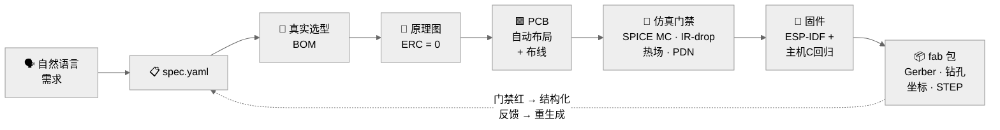
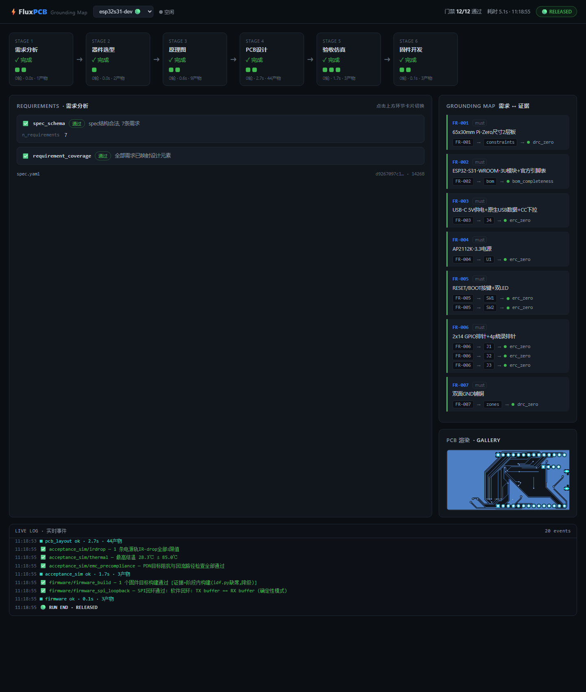

<div align="center">


<br/>

[](LICENSE)
[](https://www.python.org/)
[](https://www.kicad.org/)
[](https://github.com/DataFlux-Robot/fluxpcb)
[](https://github.com/DataFlux-Robot/fluxpcb/stargazers)

[English](README.md) · **简体中文**

</div>

---

## 📊 基准测试成绩

FluxPCB 在 **autorouter-bench** 真实板上的成绩（KiCad DRC 相机评分）：

### 2 层板 — 混合引擎（Freerouting 2.5.0 + 7 个修复算子）

| 板子 | 连接数 | 完成率 | DRC 错误 | 时间 | Koppar（基线） |
|------|--------|--------|----------|------|----------------|
| pic-programmer | 125 | **100%** | **0** | **15.8s** | 100% · 0 · 17s |
| rp2040-minimal | 150 | **100%** | **0** | **34.7s** | 100% · 0 · 11.7s |

**两块板全部追平 Koppar** —— 且 pic-programmer 的墙钟时间更短。
相比单独 Freerouting 基线，rp2040 从 86% / 4 个 DRC 错误提升到 100% / 0。

### PCBWorld-Bench（118 块真实板，按每块板自己的规则判定）

clean pass = **0 条 error 级 DRC + 0 个未连接**。

| 分组 | 板数 | 修前 | 规则同余修复后（2026-11-21） | 最新（2026-11-24） | PCBRouteAgent（PNS+LLM） |
|------|------|------|------------------------------|--------------------|--------------------------|
| D3-A（小） | 99 | 82 (82.8%) | 91 (91.9%) | **96 (97.0%)** | 94.9% |
| D3-B（中） | 10 | 8 (80.0%) | 9 (90.0%) | **9 (90.0%)** | 100% |
| D3-C（大） | 9 | 5 (55.6%) | 4 (44.4%) | 4 (44.4%) | 40% |
| **合计** | **118** | **95 (80.5%)** | **104 (88.1%)** | **109 (92.4%)** | — |

最新一列是不加限制的配置：全部修复算子启用（折线连接、网格迷宫逃逸、
短路撕开重布、线宽与间距修复）。**逐算子的贡献没有测量过。** 此前一次
三轮对比（101 → 106 → 109）看起来像迭代带来的提升，实际差值来自一个
harness 缺陷：policy 一旦禁用某个算子，凡是该算子运行过的板，**整批**
修复都会被否决（第 1 轮 13 块、第 2 轮 4 块）。目前仍有两块板未通过，
其中一块是超出时间预算。整套流程不含 LLM、不含推挤布线器，只有 DSN
导出、Freerouting 2.5.0 和事务化修复回路。

### 为什么成绩会动：一份逐板证明的契约

以上每块板此前都是用**与裁判不同的规则表**布线的。找到并修复了两个独立
原因，而且修复现在是**逐板证明**，不是声明：

1. **DSN 导出丢了项目**。`pcbnew` 按 basename 绑定项目；strip 写出
   `placed.kicad_pcb` 却没有配套的 `placed.kicad_pro`，所有网络塌缩到
   KiCad 默认类。首次审计：**118/118 不同余**（117 每网络值错、113 缺
   默认规则、57 过孔直径错）。
2. **适配器二次量化**。整数 µm 把 0.1524mm（6 mil）变成 152µm，且文本
   不匹配时静默 no-op。现在规则以精确浮点 µm 写入，补丁基于 S 表达式
   span，输出重解析后与项目表逐网络 diff。

修复后：**118/118 同余，0 读回失败**。证明是穷举表 diff
（`(net) -> width, clearance` + 默认规则 + 过孔几何），域有限所以可判定。

### 修复事务化、通过可证伪门

每批修复在字节级快照上执行，仅当严重度加权违规负载严格下降时提交
（`短路 50 · 间距 10 · 宽度 1 · 未连接 10`），规则同余是硬前提；被拒
批次逐字节恢复（54 次提交，0 次硬声明回归）。每个 pass 都经过一个已在
密封负控制上证明会失败的门，以读数集哈希为键，worst-first 合成
（7/7 门合格；118/118 同余声明通过；哈希链完整）。三个注入损坏——错误
项目、陈旧铺铜、0.4µm 量化短缺——全部被拒
（`work/pcbworld/inject_corruption.json`）。

### 为什么能做到

1. **板真实 DSN**：板子未绑定项目时（项目按 basename 绑定），KiCad 的
   Specctra 导出会写默认规则。fluxpcb 在 stripped 板旁绑定项目，把有效
   规则表以精确浮点 µm 写入，并重解析 DSN 证明读回一致
   （rp2040: 0.127mm，H7: 0.09mm）。
2. **工程文件快照恢复**：`pcbnew` 保存（strip、import-ses、以及每次重灌
   铺铜）都会用 KiCad 默认值重写配套 `.kicad_pro`；管线快照并恢复它，
   保证 DRC 判的是真实规则。
3. **7 个修复算子**（来自 pcb-hybrid-routing-advanced 技能包）：
   `copper_text_to_silk` · `width_cascade_surgery` · `policy_waiver_probe`
   （真实写 `.kicad_dru` + PROBE 验证）· `plane_bridge` · `topology_swap` ·
   `endpoint_attach`（真实画线）· `widen_narrow_tracks`
   （rp2040：74 条 neckdown 加宽，0 拒绝；2 个 1.1µm 的边缘间距豁免）。

### 4/6 层板 — NCER 引擎

| 板子 | 连接数 | 完成率 | DRC | Koppar（基线） |
|------|--------|--------|-----|----------------|
| pico-vga | 180 | — | — | 100% · 0 · 15s |
| cm5io | 431 | — | — | 100% · 0 · 542s |
| rk3328-som-evb | 462 | — | — | 100% · 0 · 66s |
| scalenode-cm4 | 446 | — | — | 100% · 0 · 161s |
| stmp157-som-evb | 905 | — | — | 100% · 0 · 1068s |
| imx8mp-som-evb | 997 | — | — | 100% · 0 · 1082s |

### H7 BGA 飞控（6 层，TFBGA240）

- 板真实 0.10mm 间距下，单次自动布线 **14 未连接 / 259 = 94.6%**
  （原 71 opens），0 个间距错误，约 460 秒。
  剩余：14 个连接器级断点 + 5 个孔间距。

---


## ⚡ 一句话需求，一条命令，一块可下单的板子

```console
$ flux run projects/esp32s31-mini

  需求分析 ─▶ spec.yaml ......... ✓ 6 条需求，全部映射
  器件选型 ─▶ bom.csv ........... ✓ 17 行，LCSC 全核实
  原理图   ─▶ .kicad_sch ........ ✓ kicad-cli ERC：0 违例
  PCB      ─▶ .kicad_pcb ........ ✓ 自动布局+布线，DRC：0
  验收仿真 ─▶ ngspice MC ×20 .... ✓ 压降 2.79% ≤ 5% · 纹波达标
  固件     ─▶ ESP-IDF ........... ✓ 主机 C 回归真实执行

  🟢 23/23 门禁全绿 — RELEASED
  fab → Gerber + 钻孔 + 贴片坐标 + STEP   (52×30 mm, 2 层)
```

**FluxPCB 把一句话变成可制造的 PCB 和它的固件**——在 16 个机器可判定门禁全部点头之前，它拒绝宣布"完成"。没有门禁，就没有交差。

---

## 🧠 AI 提议，物理裁决

LLM 能写出漂亮的网表——也会偶尔编造引脚号。FluxPCB 的铁律：**LLM 负责生成，确定性求解器与真实 EDA 工具负责裁决。** 门禁失败产出结构化反馈，流水线自动重生成，重试有界。"完成"是物理结论，不是感觉良好。



---

## 🚦 16 个门禁，零个"我觉得行"

每个产物带 SHA256 哈希，每个结论可追溯到磁盘证据。工具缺席 = `BLOCKED`——**绝不**伪装通过。

| 环节 | 门禁 | 到底查什么 |
|---|---|---|
| 📋 需求分析 | `spec_schema` `requirement_coverage` | 每条需求必须映射到设计元素 |
| 🔩 器件选型 | `bom_completeness` `bom_lcsc_verified` | 占位料号**直接判 FAIL**；JLC 在线核验 + 快照降级 |
| 📐 原理图 | `erc_zero` `netlist_topology` | 真实 `kicad-cli` ERC · spec 声明的连接逐脚回读 |
| 🟩 PCB 设计 | `placement_quality` `drc_zero` `impedance_si` | 重叠/去耦/连接器规则 · 真实 `kicad-cli` DRC · IPC-2141 + 等长断言 |
| 🧪 验收仿真 | `irdrop` `thermal` `emc_precompliance` `spice_functional` | FDM 场求解 · PDN 目标阻抗 · ngspice 蒙特卡洛（20 次，电容/ESR ±20%） |
| 💾 固件开发 | `firmware_build` `firmware_spi_loopback` `firmware_regression` | idf.py 在场时真实编译 · 与目标固件**同源**的 `fw_logic.c` 在主机真实编译执行 |

---

## 🖥️ Grounding Map —— 可点击的追溯链

每条需求 `FR-xxx` → 覆盖它的设计元素 → 裁决它的门禁。未覆盖需求高亮；每个结论回溯到带哈希的产物。

<div align="center">

</div>

```bash
flux dashboard projects    # → http://127.0.0.1:8765 · 零依赖 · 离线可用
```

---

## 🏆 从 prompt 到 fab 包

<table>
<tr>
<td width="50%" align="center">
<br/>
<b>esp32s31-mini</b> · 全自动演示<br/>
52×30 mm · 2 层 · 自动布局 + 自动布线<br/>
<code>23/23 🟢 RELEASED</code><br/>
<a href="gallery/esp32s31-mini/esp32s31-mini-pcb.zip">⬇ fab 包</a> · <a href="gallery/esp32s31-mini/prompt.md">原始 prompt</a>
</td>
<td width="50%" align="center">
<br/>
<b>esp32s31-dev</b> · 旗舰板（Pi-Zero 尺寸）<br/>
65×30 mm · 99 脚引脚表逐项取自 Espressif 官方数据手册<br/>
<code>12/12 🟢 ERC=0 · DRC=0</code><br/>
<a href="gallery/esp32s31-dev/esp32s31-dev-pcb.zip">⬇ KiCad 工程</a> · <a href="gallery/esp32s31-dev/prompt.md">原始 prompt</a>
</td>
</tr>
</table>

---

## 🤖 在 Claude Code 里驱动它

仓库自带 `/fluxpcb` 技能（`.claude/commands/fluxpcb.md`）：

```
/fluxpcb ESP32-S31迷你开发板,USB-C供电,双排针,1按键1LED
```

一句话 → 自动建项目 → 六环节流水线 → 有界修门禁（≤5 轮）→ fab 包 → 带证据链的报告。**内置铁律：不得编造 datasheet 外的引脚，不得调门禁阈值放水。**

> **能力边界（如实声明）：** 当前流水线支持 **ESP32-S31 开发板家族的参数化变体**——模块 + USB-C + LDO + 排针（1–2 排 × 4–14 脚）+ 1–2 按键 + 1–2 LED + 烧录排针，板尺寸/层数可调。超出该家族的需求，技能会明说，而不是假装支持。

---

## 🚀 快速开始

只需 **Python ≥ 3.10**。其余全部可选——工具缺席时相关门禁变 `BLOCKED`，而不是变绿。

```bash
pip install -e .

flux run      projects/esp32s31-mini   # 全流程 → RELEASED
flux report   projects/esp32s31-mini   # 审计报告，结论带证据链
flux gate     projects/esp32s31-dev --only impedance_si,irdrop
flux verify   projects/esp32s31-mini   # 只复检门禁，不重新生成
flux dashboard projects                # Grounding Map 面板
```

| 可选工具 | 解锁能力 |
|---|---|
| KiCad 10+（kicad-cli） | 真实 ERC / DRC 裁决，Gerber/钻孔/坐标/STEP 导出 |
| Freerouting | 批量自动布线（DSN/SES） |
| ngspice（KiCad 自带 DLL） | LDO 电源链瞬态蒙特卡洛 |
| openEMS + gerber2ems | 阻抗/S 参数/EM 场终验（*适配器已就绪，接线中*） |
| ESP-IDF / hpm-sdk | 固件真实编译门禁 |
| LCSC / JLC API | 器件与价格在线核验（快照降级） |

零依赖纯 Python 物理内核，随时可用：**IPC-2141** 阻抗（对拍 <5%）、**FDM** IR-drop/热场、**PDN** 目标阻抗。

---

## 📍 项目状态

- ✅ **Phase A** —— 编排引擎 + 门禁框架 + 物理内核 + CLI · 26 个单元测试全绿
- ✅ **Phase B1** —— ESP32-S31 开发板 · ERC=0 · DRC=0 · 12/12 门禁 · Gerber 已导出
- 🔲 **Phase B2** —— HPM6E80 核心板（BGA 球阵映射待 FAE 数据手册）
- 🧭 **Phase D** —— 见 [ROADMAP.md](ROADMAP.md)：板族扩展、SA/NSGA-II 布局优化、openEMS 终验、MCP 服务器形态、第七环节（系统级联合仿真）

## 🕊️ 工程诚实

- 2025 新料 LCSC 未公开索引 → BOM 标注"下单前人工核实"，占位料号永远过不了门禁。
- 稠密板的布线"最后一公里"缺口在报告中**保持可见**（`unconnected=ignore`），绝不悄悄关闭。
- JLC 在线核验有 bot 防护（HTTP 460）→ 自动降级到检入的 partslib 快照。

---

<div align="center">

**如果 FluxPCB 帮你省了一次打板 respin —— 留个 ⭐，它会变成下一个门禁。**

[报告问题](https://github.com/DataFlux-Robot/fluxpcb/issues) · [路线图](ROADMAP.md) · Apache-2.0 © FluxPCB contributors

<a href="https://star-history.com/#DataFlux-Robot/fluxpcb&Date"></a>

</div>
