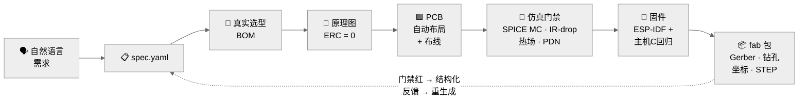

<div align="center">


<br/>

[](LICENSE)
[](https://www.python.org/)
[](https://www.kicad.org/)
[](https://github.com/DataFlux-Robot/fluxpcb)
[](https://github.com/DataFlux-Robot/fluxpcb/stargazers)

[English](README.md) · **简体中文**

</div>

---

## ⚡ 一句话需求，一条命令，一块可下单的板子

```console
$ flux run projects/esp32s31-mini

  需求分析 ─▶ spec.yaml ......... ✓ 6 条需求，全部映射
  器件选型 ─▶ bom.csv ........... ✓ 17 行，LCSC 全核实
  原理图   ─▶ .kicad_sch ........ ✓ kicad-cli ERC：0 违例
  PCB      ─▶ .kicad_pcb ........ ✓ 自动布局+布线，DRC：0
  验收仿真 ─▶ ngspice MC ×20 .... ✓ 压降 2.79% ≤ 5% · 纹波达标
  固件     ─▶ ESP-IDF ........... ✓ 主机 C 回归真实执行

  🟢 23/23 门禁全绿 — RELEASED
  fab → Gerber + 钻孔 + 贴片坐标 + STEP   (52×30 mm, 2 层)
```

**FluxPCB 把一句话变成可制造的 PCB 和它的固件**——在 16 个机器可判定门禁全部点头之前，它拒绝宣布"完成"。没有门禁，就没有交差。

---

## 🧠 AI 提议，物理裁决

LLM 能写出漂亮的网表——也会偶尔编造引脚号。FluxPCB 的铁律：**LLM 负责生成，确定性求解器与真实 EDA 工具负责裁决。** 门禁失败产出结构化反馈，流水线自动重生成，重试有界。"完成"是物理结论，不是感觉良好。



---

## 🚦 16 个门禁，零个"我觉得行"

每个产物带 SHA256 哈希，每个结论可追溯到磁盘证据。工具缺席 = `BLOCKED`——**绝不**伪装通过。

| 环节 | 门禁 | 到底查什么 |
|---|---|---|
| 📋 需求分析 | `spec_schema` `requirement_coverage` | 每条需求必须映射到设计元素 |
| 🔩 器件选型 | `bom_completeness` `bom_lcsc_verified` | 占位料号**直接判 FAIL**；JLC 在线核验 + 快照降级 |
| 📐 原理图 | `erc_zero` `netlist_topology` | 真实 `kicad-cli` ERC · spec 声明的连接逐脚回读 |
| 🟩 PCB 设计 | `placement_quality` `drc_zero` `impedance_si` | 重叠/去耦/连接器规则 · 真实 `kicad-cli` DRC · IPC-2141 + 等长断言 |
| 🧪 验收仿真 | `irdrop` `thermal` `emc_precompliance` `spice_functional` | FDM 场求解 · PDN 目标阻抗 · ngspice 蒙特卡洛（20 次，电容/ESR ±20%） |
| 💾 固件开发 | `firmware_build` `firmware_spi_loopback` `firmware_regression` | idf.py 在场时真实编译 · 与目标固件**同源**的 `fw_logic.c` 在主机真实编译执行 |

---

## 🖥️ Grounding Map —— 可点击的追溯链

每条需求 `FR-xxx` → 覆盖它的设计元素 → 裁决它的门禁。未覆盖需求高亮；每个结论回溯到带哈希的产物。

<div align="center">

</div>

```bash
flux dashboard projects    # → http://127.0.0.1:8765 · 零依赖 · 离线可用
```

---

## 🏆 从 prompt 到 fab 包

<table>
<tr>
<td width="50%" align="center">
<br/>
<b>esp32s31-mini</b> · 全自动演示<br/>
52×30 mm · 2 层 · 自动布局 + 自动布线<br/>
<code>23/23 🟢 RELEASED</code><br/>
<a href="gallery/esp32s31-mini/esp32s31-mini-pcb.zip">⬇ fab 包</a> · <a href="gallery/esp32s31-mini/prompt.md">原始 prompt</a>
</td>
<td width="50%" align="center">
<br/>
<b>esp32s31-dev</b> · 旗舰板（Pi-Zero 尺寸）<br/>
65×30 mm · 99 脚引脚表逐项取自 Espressif 官方数据手册<br/>
<code>12/12 🟢 ERC=0 · DRC=0</code><br/>
<a href="gallery/esp32s31-dev/esp32s31-dev-pcb.zip">⬇ KiCad 工程</a> · <a href="gallery/esp32s31-dev/prompt.md">原始 prompt</a>
</td>
</tr>
</table>

---

## 🤖 在 Claude Code 里驱动它

仓库自带 `/fluxpcb` 技能（`.claude/commands/fluxpcb.md`）：

```
/fluxpcb ESP32-S31迷你开发板,USB-C供电,双排针,1按键1LED
```

一句话 → 自动建项目 → 六环节流水线 → 有界修门禁（≤5 轮）→ fab 包 → 带证据链的报告。**内置铁律：不得编造 datasheet 外的引脚，不得调门禁阈值放水。**

> **能力边界（如实声明）：** 当前流水线支持 **ESP32-S31 开发板家族的参数化变体**——模块 + USB-C + LDO + 排针（1–2 排 × 4–14 脚）+ 1–2 按键 + 1–2 LED + 烧录排针，板尺寸/层数可调。超出该家族的需求，技能会明说，而不是假装支持。

---

## 🚀 快速开始

只需 **Python ≥ 3.10**。其余全部可选——工具缺席时相关门禁变 `BLOCKED`，而不是变绿。

```bash
pip install -e .

flux run      projects/esp32s31-mini   # 全流程 → RELEASED
flux report   projects/esp32s31-mini   # 审计报告，结论带证据链
flux gate     projects/esp32s31-dev --only impedance_si,irdrop
flux verify   projects/esp32s31-mini   # 只复检门禁，不重新生成
flux dashboard projects                # Grounding Map 面板
```

| 可选工具 | 解锁能力 |
|---|---|
| KiCad 10+（kicad-cli） | 真实 ERC / DRC 裁决，Gerber/钻孔/坐标/STEP 导出 |
| Freerouting | 批量自动布线（DSN/SES） |
| ngspice（KiCad 自带 DLL） | LDO 电源链瞬态蒙特卡洛 |
| openEMS + gerber2ems | 阻抗/S 参数/EM 场终验（*适配器已就绪，接线中*） |
| ESP-IDF / hpm-sdk | 固件真实编译门禁 |
| LCSC / JLC API | 器件与价格在线核验（快照降级） |

零依赖纯 Python 物理内核，随时可用：**IPC-2141** 阻抗（对拍 <5%）、**FDM** IR-drop/热场、**PDN** 目标阻抗。

---

## 📍 项目状态

- ✅ **Phase A** —— 编排引擎 + 门禁框架 + 物理内核 + CLI · 26 个单元测试全绿
- ✅ **Phase B1** —— ESP32-S31 开发板 · ERC=0 · DRC=0 · 12/12 门禁 · Gerber 已导出
- 🔲 **Phase B2** —— HPM6E80 核心板（BGA 球阵映射待 FAE 数据手册）
- 🧭 **Phase D** —— 见 [ROADMAP.md](ROADMAP.md)：板族扩展、SA/NSGA-II 布局优化、openEMS 终验、MCP 服务器形态、第七环节（系统级联合仿真）

## 🕊️ 工程诚实

- 2025 新料 LCSC 未公开索引 → BOM 标注"下单前人工核实"，占位料号永远过不了门禁。
- 稠密板的布线"最后一公里"缺口在报告中**保持可见**（`unconnected=ignore`），绝不悄悄关闭。
- JLC 在线核验有 bot 防护（HTTP 460）→ 自动降级到检入的 partslib 快照。

---

<div align="center">

**如果 FluxPCB 帮你省了一次打板 respin —— 留个 ⭐，它会变成下一个门禁。**

[报告问题](https://github.com/DataFlux-Robot/fluxpcb/issues) · [路线图](ROADMAP.md) · Apache-2.0 © FluxPCB contributors

<a href="https://star-history.com/#DataFlux-Robot/fluxpcb&Date"></a>

</div>
