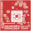
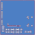
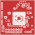
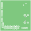
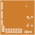
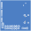

# 案例 4：stm32h743-px4 — H743 TFBGA240 PX4飞控（36×36·6层）

## Prompt（当时的提示词）

> 用fluxpcb开发36mm×36mm的H743 bga PX4飞控。

## 一条命令

```bash
FLUXNT_MCU=h743 flux run projects/stm32h743-px4    # → 🟢 RELEASED 23/23门禁
```

## 数据链

| 数据 | 来源 |
|---|---|
| STM32H743XI TFBGA240（265球,17×17@0.8mm） | **ST官方** STM32H743XIHx.xml（open_pin_data仓库）|
| 34个PX4外设功能球 | ST官方XML直出，优先级分配器（USB/SWD独占脚优先）|
| 封装 | XML球位直出BGA240封装生成器 |
| 传感器 | 与N6案例同源（ArduPilot/GUDrones/AUXSPACE核实pin表）|

## 效果



<details>
<summary>六层铜箔布线</summary>



</details>

## 逐层视图（6层真实铜）

| 层 | 角色 | 视图 |
|---|---|---|
| F.Cu | 信号+器件 |  |
| In1.Cu | GND平面 |  |
| In2.Cu | 3V3电源平面 |  |
| In3.Cu | 5V电源平面 |  |
| In4.Cu | GND平面 |  |
| B.Cu | 信号+器件 |  |

## 门禁明细（23/23）

ERC=0错 · DRC=0 · 几何DC双轨解(3V3/VCAP) · 腔模 · PDN-AC · MC200+3角点 · 主机C回归 —— 全绿。

## 下载

- [stm32h743-px4-pcb.zip](stm32h743-px4-pcb.zip) — 6层Gerber+钻孔+坐标+STEP（17文件）

## 与N6案例的差异（板族MCU抽象的价值）

| | stm32n6-px4 | stm32h743-px4 |
|---|---|---|
| MCU | STM32N657 TFBGA264 | STM32H743 TFBGA240 |
| 核心电源 | 片内SMPS+外部2.2µH电感 | 片内LDO+VCAP电容（无电感） |
| USB | OTG_HS | OTG_FS |
| 板形 | 55×28矩形 | 36×36方形 |

同一板族生成器（px4fmu）、同一布局精化/分类布线/门禁链——换MCU=换一个XML文件。
